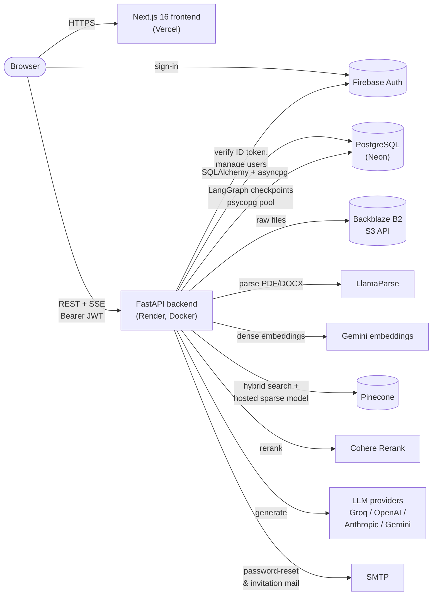
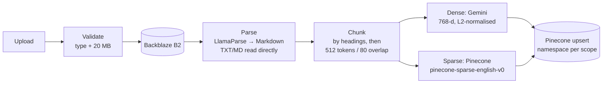
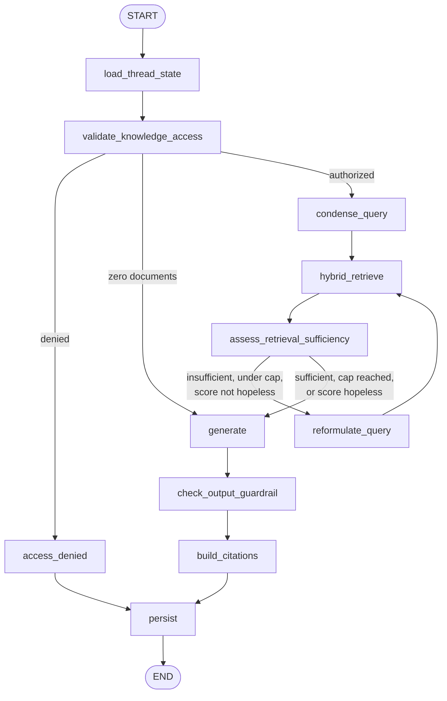
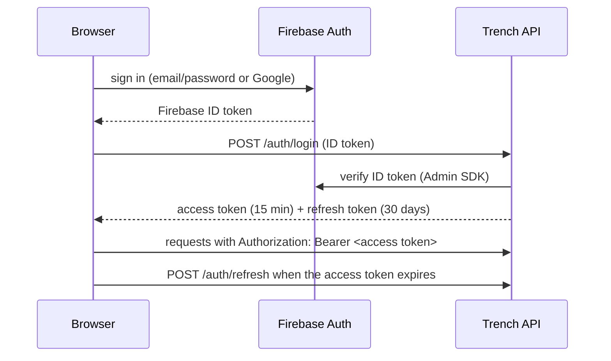
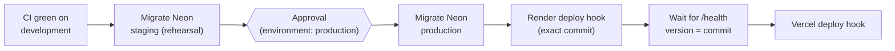

<div align="center">

<picture>
  <source media="(prefers-color-scheme: dark)" srcset="docs/assets/trench-logo-dark.svg">
  
</picture>

**Chat with your documents. Every answer cited back to its source.**

An agentic RAG (retrieval-augmented generation) knowledge assistant for individuals and teams:
upload PDFs, Word files and notes, then ask questions in natural language and get streamed,
citation-backed answers grounded only in your own knowledge base.

[](https://github.com/pavankumarbattineni/Trench/actions/workflows/ci.yml)


</div>

---

## Table of contents

- [Overview](#overview)
- [Features](#features)
- [Architecture](#architecture)
- [Tech stack](#tech-stack)
- [Repository structure](#repository-structure)
- [Getting started](#getting-started)
  - [Prerequisites](#prerequisites)
  - [Option A: Docker Compose (recommended)](#option-a-docker-compose-recommended)
  - [Option B: Run natively](#option-b-run-natively)
- [Configuration](#configuration)
- [How it works](#how-it-works)
  - [Document ingestion](#document-ingestion)
  - [The agentic RAG graph](#the-agentic-rag-graph)
  - [Generation, citations and guardrails](#generation-citations-and-guardrails)
  - [Streaming, cancellation and persistence](#streaming-cancellation-and-persistence)
  - [Tunable constants](#tunable-constants)
- [Authentication, tenants and access control](#authentication-tenants-and-access-control)
- [Models and bring-your-own-key](#models-and-bring-your-own-key)
- [API reference](#api-reference)
- [Frontend](#frontend)
- [Database and migrations](#database-and-migrations)
- [Testing and code quality](#testing-and-code-quality)
- [CI/CD](#cicd)
- [Docker images](#docker-images)
- [Deployment](#deployment)
- [Maintenance scripts](#maintenance-scripts)
- [Known limitations](#known-limitations)
- [Troubleshooting](#troubleshooting)
- [Contributing](#contributing)

---

## Overview

Trench is a full-stack application made of two services:

| Service | Folder | What it does |
|---|---|---|
| **Backend** | [`trench_backend/`](trench_backend/) | FastAPI REST + SSE API. Owns auth sessions, tenants, documents, the ingestion pipeline and the LangGraph agent that answers questions. |
| **Frontend** | [`trench_frontend/`](trench_frontend/) | Next.js 16 (App Router) web app: sign-in, chat, document library, team management and settings. |

Two knowledge scopes are kept strictly separate:

- **Personal knowledge**: documents only you can query.
- **Company knowledge**: documents shared across a tenant (team), queryable by members who have been granted access.

Every question runs through an agentic pipeline that rewrites follow-ups into standalone questions,
performs **hybrid (semantic + keyword) search**, **reranks** the results, checks whether what it found is
good enough (and retries with a reformulated query if not), then streams an answer whose factual claims
carry numbered citations such as `[1]`, `[2]` that link back to the exact source passage.

## Features

**Chat**
- Streaming answers over Server-Sent Events, with stop/cancel and "continue" after an interruption
- Inline numbered citations linked to the source document and passage
- Markdown rendering with GitHub-flavoured tables, **LaTeX math** (KaTeX) and **Mermaid diagrams**
- Multi-turn conversations: follow-ups like "continue" or "what about the second one?" are understood in context
- Threads with auto-generated titles, renaming and deletion
- Switch between personal and company knowledge per message

**Documents**
- Upload **PDF, DOCX, TXT and Markdown** (up to 20 MB each) via drag and drop
- Layout-aware parsing (tables, multi-column, scanned pages via OCR) through LlamaParse
- Background ingestion with live status (processing, completed, failed, with retry)
- Secure downloads via short-lived presigned URLs; deletion removes every stored vector
- Free tier of 5 documents; unlimited with your own Pinecone key

**Teams**
- Workspace (tenant) creation on owner sign-up; email invitations
- Roles: **Owner**, **Admin**, **Member**; explicit grant/revoke of company-knowledge access
- Tenant isolation enforced on every query before it reaches the vector store

**Models**
- Platform default model (Groq `openai/gpt-oss-120b`) works out of the box
- Bring your own key for **OpenAI, Anthropic, Google Gemini and Groq**; keys are validated on save and encrypted at rest
- Per-user model selection from a curated, seeded catalog

**Account**
- Email/password and Google sign-in (Firebase Authentication)
- Change password, forgot/reset password by email, account deletion (wipes your vectors too)
- Light/dark/system theme

## Architecture



The browser talks to the backend directly (the frontend is a client of the API, not a proxy).
Authentication is a two-step handshake: Firebase proves *who you are*, then the backend issues its own
short-lived access token and longer-lived refresh token (stateless JWTs) that authorize every API call.

## Tech stack

| Layer | Technology |
|---|---|
| Frontend | Next.js 16 (App Router, standalone output), React 19, TypeScript, Tailwind CSS 4, shadcn/ui + Base UI, TanStack Query, React Hook Form + Zod, react-markdown + remark-gfm/math + rehype-katex, Mermaid, Sonner |
| Backend | Python 3.13, FastAPI, Uvicorn, Pydantic Settings, SQLAlchemy 2 (async) + asyncpg, Alembic |
| Agent / RAG | LangGraph (Postgres checkpointer), LlamaParse, LangChain text splitters, tiktoken, Gemini `gemini-embedding-001`, Pinecone (`pinecone-sparse-english-v0` hosted sparse model), Cohere `rerank-v3.5` |
| LLMs | Groq, OpenAI, Anthropic, Google Gemini |
| Auth | Firebase Authentication (client + Admin SDK), PyJWT, Fernet encryption for stored API keys |
| Storage | PostgreSQL 18, Pinecone, Backblaze B2 (S3-compatible, boto3) |
| Tooling | uv, ruff, pytest + pytest-asyncio + pytest-cov, ESLint, npm |
| Ops | Docker (multi-stage, non-root), Docker Compose, GitHub Actions, Dependabot, Trivy, LangSmith tracing (optional) |

## Repository structure

```text
Trench/
├── compose.yaml                 # Full local stack: postgres + migrate + backend + frontend
├── compose.override.yaml        # Dev overrides (hot reload), applied automatically
├── .github/
│   ├── workflows/ci.yml         # CI: lint, tests, builds, image scans
│   └── dependabot.yml           # Weekly dependency update PRs
├── docs/assets/                 # README logo
├── trench_backend/
│   ├── Dockerfile               # Multi-stage uv build, non-root runtime
│   ├── pyproject.toml / uv.lock # Dependencies (uv)
│   ├── alembic/                 # Database migrations
│   ├── scripts/                 # Seed, re-index and cleanup scripts
│   ├── tests/                   # pytest suite (~370 tests)
│   └── app/
│       ├── main.py              # FastAPI app, routers, CORS, lifespan
│       ├── config.py            # TRENCH_CONFIG schema (Pydantic)
│       ├── router/              # HTTP endpoints (auth, chat, documents, ...)
│       ├── schemas/             # Request/response models
│       ├── service/             # Business logic (ingestion, retrieval, LLMs, ...)
│       ├── graph/               # LangGraph agent: rag_graph.py, state.py
│       ├── database/            # SQLAlchemy models, session, checkpointer
│       ├── middleware/          # Request middleware
│       └── utils/               # Security, SSE, stream manager, validation
└── trench_frontend/
    ├── Dockerfile               # Multi-stage Next.js standalone build
    ├── next.config.ts
    └── src/
        ├── app/                 # Routes (App Router)
        ├── components/          # UI: chat, documents, settings, app shell, ui/
        ├── hooks/               # React hooks
        ├── lib/                 # API client, auth, Firebase, chat streaming
        └── proxy.ts             # Route protection (Next.js proxy)
```

## Getting started

### Prerequisites

| Tool | Version | Needed for |
|---|---|---|
| [Docker Desktop](https://www.docker.com/products/docker-desktop/) (WSL 2 on Windows) | recent | Option A |
| [uv](https://docs.astral.sh/uv/) | 0.13+ | Option B (backend) |
| [Node.js](https://nodejs.org/) | 24 LTS | Option B (frontend) |
| PostgreSQL | 18 | Option B |

External accounts (all have free tiers): **Firebase** (Authentication with Email/Password and Google
providers enabled), **Pinecone** (a `dotproduct` index named `trench-platform`, 768 dimensions),
**Google AI Studio** (Gemini API key), **Groq**, **Cohere**, **LlamaCloud** (LlamaParse),
**Backblaze B2** (bucket + application key) and an **SMTP** account for outgoing mail.

### 1. Clone and configure

```bash
git clone https://github.com/pavankumarbattineni/Trench.git
cd Trench

# Backend secrets: copy the template and fill in every value
cp trench_backend/.env.example trench_backend/.env

# Frontend public config (Firebase web app settings + API URL)
cat > trench_frontend/.env.local <<'EOF'
NEXT_PUBLIC_API_BASE_URL=http://localhost:8000
NEXT_PUBLIC_FIREBASE_API_KEY=...
NEXT_PUBLIC_FIREBASE_AUTH_DOMAIN=...
NEXT_PUBLIC_FIREBASE_PROJECT_ID=...
NEXT_PUBLIC_FIREBASE_STORAGE_BUCKET=...
NEXT_PUBLIC_FIREBASE_MESSAGING_SENDER_ID=...
NEXT_PUBLIC_FIREBASE_APP_ID=...
EOF
```

> [!IMPORTANT]
> `.env`, `.env.local`, `.env.docker`, `.env.compose` and any service-account JSON are git-ignored.
> Never commit them.

### Option A: Docker Compose (recommended)

Compose runs four containers on one private network:

| Service | Image | Role |
|---|---|---|
| `postgres` | `postgres:18` | Database; data in the `pgdata` named volume (host port **5433**) |
| `migrate` | backend image | One-off job: `alembic upgrade head` + provider seed, then exits |
| `backend` | built from `trench_backend/` | API on **:8000**, memory-capped at 512 MB (matches Render free) |
| `frontend` | built from `trench_frontend/` | Web app on **:3000** |

Startup order is enforced with health checks: `postgres` healthy → `migrate` completed successfully →
`backend` healthy → `frontend`.

1. Create `trench_backend/.env.compose` with the database credentials and a single-line
   `TRENCH_CONFIG` whose `DB` section points at the Compose database:

   ```dotenv
   POSTGRES_USER=trench
   POSTGRES_PASSWORD=<a long random password>
   POSTGRES_DB=trench
   TRENCH_CONFIG={"ENVIRONMENT":"DEV", "DB":{"username":"trench","password":"<same password>","database":"trench","ip_address":"postgres","port":"5432"}, ...rest as in .env...}
   ```

   (Docker env files are read line by line: keep `TRENCH_CONFIG` on **one line** and unquoted.
   `ip_address` is the Compose service name `postgres`.)

2. Start everything:

   ```bash
   docker compose --env-file trench_frontend/.env.local up --build -d
   ```

   `--env-file` supplies the `NEXT_PUBLIC_*` values that are baked into the frontend bundle at build time.

3. Open <http://localhost:3000>. API docs: <http://localhost:8000/docs>.

Everyday commands:

```bash
docker compose ps                      # status of every service
docker compose logs -f backend         # follow backend logs
docker compose down                    # stop (database volume is kept)
docker compose down -v                 # stop AND delete the database volume
docker compose -f compose.yaml up -d   # production-like run, without dev overrides
```

`compose.override.yaml` is applied automatically and enables **hot reload**: `trench_backend/app/` is
bind-mounted into the container and Uvicorn restarts on every save (file polling is enabled because
change events don't cross from Windows into containers).

<details>
<summary>Copying an existing local database into the Compose database</summary>

The backend never creates users on login, so to reuse existing accounts copy your data across
(this only reads the source database):

```bash
docker compose up -d postgres
PGPASSWORD=<local password> pg_dump -h localhost -U postgres -d trench --no-owner --no-acl \
  | docker compose exec -T postgres psql -U trench -d trench -v ON_ERROR_STOP=1
```
</details>

### Option B: Run natively

**Backend**

```bash
cd trench_backend
uv sync                                    # creates .venv with exact locked versions
uv run alembic upgrade head                # create/upgrade the schema
uv run python scripts/seed_provider_catalog.py   # LLM provider + model catalog
uv run uvicorn app.main:app --reload --port 8000
```

**Frontend**

```bash
cd trench_frontend
npm ci
npm run dev                                # http://localhost:3000
```

**Inspect the agent graph** in LangGraph Studio (uses `trench_backend/langgraph.json`):

```bash
cd trench_backend && uv run langgraph dev
```

## Configuration

### Backend: `TRENCH_CONFIG`

All backend settings live in one JSON environment variable, validated at startup by
[`app/config.py`](trench_backend/app/config.py). See [`.env.example`](trench_backend/.env.example) for a full template.

| Section | Keys | Purpose |
|---|---|---|
| `ENVIRONMENT` | `"DEV"` / `"PROD"` | Environment name |
| `FRONTEND_BASE_URL` | URL, no trailing slash | Used in emailed links (invitations, password reset); also the default CORS origin |
| `CORS_ORIGINS` | list of URLs (optional) | Browser origins allowed to call the API. Defaults to `[FRONTEND_BASE_URL]` |
| `DB` | `username`, `password`, `database`, `ip_address`, `port`, `pool_size`, `max_overflow`, `pool_timeout`, `pool_recycle`, `ssl` | PostgreSQL connection and pool. Set `ssl: true` for hosted databases such as Neon |
| `JWT` | `secret_key`, `algorithm`, `access_token_expire_minutes` (15), `refresh_token_expire_days` (30) | Trench session tokens |
| `ENCRYPTION` | `encryption_key` | Root secret for encrypting stored provider API keys |
| `FIREBASE` | `credentials_json_base64`, `web_api_key` | Admin SDK service account (base64, `base64 -w0 key.json`) |
| `GROQ` | `api_key`, `tokens_per_minute` | Platform default LLM |
| `BACKBLAZE` | `endpoint_url`, `region`, `bucket_name`, `application_key_id`, `application_key` | Document file storage |
| `PINECONE` | `api_key`, `index_name` | Vector index + hosted sparse model |
| `LLAMAPARSE` | `api_key` | PDF/DOCX parsing |
| `COHERE_RERANKER` | `api_key` | Reranking |
| `GEMINI` | `api_key`, `embed_requests_per_minute` | Dense embeddings |
| `SMTP` | `host`, `port`, `username`, `password`, `from_address`, `use_tls` | Outgoing email |
| `STORAGE` | `local_root_path` | Legacy, unused |

Optional plain variables for [LangSmith](https://smith.langchain.com/) tracing: `LANGSMITH_API_KEY`,
`LANGCHAIN_ENDPOINT`, `LANGCHAIN_TRACING`, `LANGCHAIN_PROJECT`.

### Frontend: `NEXT_PUBLIC_*`

| Variable | Purpose |
|---|---|
| `NEXT_PUBLIC_API_BASE_URL` | Backend origin, e.g. `http://localhost:8000` (the app appends `/api/v1`) |
| `NEXT_PUBLIC_FIREBASE_*` | Firebase web app config (`API_KEY`, `AUTH_DOMAIN`, `PROJECT_ID`, `STORAGE_BUCKET`, `MESSAGING_SENDER_ID`, `APP_ID`) |

These are **public** (they end up in the browser bundle) and are fixed at **build time**: changing one
means rebuilding the frontend.

## How it works

### Document ingestion



1. **Validate and store**: MIME type and size are checked, the raw file goes to Backblaze B2, and a
   `documents` row is created. Ingestion then runs in the background; the UI polls its status.
2. **Parse**: PDF/DOCX are sent to LlamaParse (`result_type="markdown"`), which keeps headings and tables;
   TXT/MD are decoded directly.
3. **Chunk**: `MarkdownHeaderTextSplitter` first splits on `#`–`####` so no chunk straddles two sections,
   then each section is split into ≤ 512-token chunks with 80-token overlap (counted with `cl100k_base`).
   Each chunk records its `heading_path`, e.g. `Refunds > Timelines`.
4. **Contextual embedding text**: what's embedded is `document name + heading path + chunk text`, so a
   chunk carries the context of where it came from. The stored `text` metadata stays the raw chunk.
5. **Encode**:
   - *Dense* (meaning): Gemini `gemini-embedding-001` at 768 dimensions, L2-normalised manually
     (Gemini only normalises at its native 3072 dimensions).
   - *Sparse* (keywords): Pinecone's hosted `pinecone-sparse-english-v0` model (`input_type=passage`).
6. **Upsert** to Pinecone with deterministic IDs `"{document_id}:{chunk_index}"` into the namespace
   `personal:{user_id}` or `company:{tenant_id}`. Both vectors are pre-scaled for hybrid weighting
   (dense × 0.7, sparse × 0.3) so a single `dotproduct` query combines them.

Deleting a document removes its vectors by ID prefix (`{document_id}:`), so nothing is orphaned even if a
previous ingestion was partial.

### The agentic RAG graph

Each chat turn runs a LangGraph `StateGraph` ([`app/graph/rag_graph.py`](trench_backend/app/graph/rag_graph.py)),
compiled once with a Postgres checkpointer that stores conversation state per thread.



| Node | What it does |
|---|---|
| `load_thread_state` | Placeholder hook; prior messages are restored automatically by the checkpointer |
| `validate_knowledge_access` | Resolves the scope (personal or company), checks tenant membership and role/grant, and notes whether the scope has any documents. Re-checked fresh every turn |
| `access_denied` | Streams the denial reason and ends the turn |
| `condense_query` | If there's history, rewrites the follow-up into a standalone question using the platform default model (never the user's BYOK quota). Falls back to the raw query on any failure |
| `hybrid_retrieve` | Dense + sparse query to Pinecone (25 candidates) in exactly one namespace, then Cohere `rerank-v3.5` down to the best 8 |
| `assess_retrieval_sufficiency` | Sufficient if the top rerank score is ≥ 0.3. Tracks the best attempt so far |
| `reformulate_query` | Rewrites the *original* standalone question (never a previous rewrite, so drift doesn't compound) and retries. At most 2 attempts in total; skipped entirely if the latest score is < 0.05 (nothing relevant exists) |
| `generate` | Streams the answer token by token with the user's selected model and credential |
| `check_output_guardrail` | Redacts credential-shaped strings from the final answer |
| `build_citations` | Maps `[n]` markers in the answer to the passages that were shown to the model |
| `persist` | Saves the assistant message, sends the final `done` event and closes the stream |

### Generation, citations and guardrails

- **No-relevant-context floor**: Pinecone almost always returns *something*, so chunks scoring below
  0.1 after reranking are discarded. `generate` and `build_citations` use this same filtered list, so
  citation numbers can never disagree with what the model saw.
- **Three system prompts**: `empty_kb` (the scope has no documents, so it suggests uploading),
  `no_context` (a search ran but found nothing relevant, so it must not cite) and `normal` (numbered
  passages `[1] (from file.pdf) ...`, citations required).
- **History window**: the last 10 prior messages are sent to `condense_query` and `generate`; the full
  history is still stored.
- **Citations**: `[n]` (and full-width `【n】`) markers are extracted, de-duplicated, range-checked and
  returned with their source passage, document name and heading path.
- **Output guardrail**: redacts OpenAI/Anthropic, Google, Groq, GitHub, AWS and Slack key shapes, PEM private
  keys and URLs with embedded passwords, replacing each with `[REDACTED]`. It protects the stored message
  and the final `done` event; tokens already streamed can't be un-sent.
- **Request limits** (before the graph runs): queries are capped at 4,000 characters (422), and each user
  gets 20 chat messages per 60 seconds (429 with `Retry-After`).

### Streaming, cancellation and persistence

- `POST /api/v1/chat/threads/{id}/messages` stores the user message, creates a pending assistant message,
  starts the graph as a background task and returns a `stream_id`.
- `GET /api/v1/chat/streams/{stream_id}` is an SSE stream with events `token`, `done` (full text +
  citations), `error` and `interrupted`. An in-memory stream manager buffers events, so a client
  that reconnects (`Last-Event-ID`) catches up on what it missed.
- `DELETE /api/v1/chat/streams/{stream_id}` cancels generation. The partial answer is saved with status
  `interrupted` and written into the conversation state, so a following "continue" picks up where it
  stopped.
- Graph checkpoints are stored in Postgres (`checkpoints`, `checkpoint_blobs`, `checkpoint_writes`) through
  a separate psycopg pool, and written synchronously so a finished turn is always in the next turn's history.

| Failure | What the user sees |
|---|---|
| Missing BYOK key for the selected model (personal) | `error` event asking to add the key or switch model |
| Missing tenant key (company) | Silently falls back to the platform default model |
| Pinecone / Cohere / LLM exception | `error` event; message saved with status `failed` |
| No access to company knowledge | `error` event with the denial reason |
| Ingestion failure | Document marked `failed` with the error; retry available |

### Tunable constants

| Constant | Value | File |
|---|---|---|
| `MAX_RETRIEVAL_ATTEMPTS` | 2 | `app/graph/rag_graph.py` |
| `RETRIEVAL_SUFFICIENCY_MIN_RERANK_SCORE` | 0.3 | `app/graph/rag_graph.py` |
| `RETRIEVAL_SKIP_RETRY_BELOW` | 0.05 | `app/graph/rag_graph.py` |
| `MIN_USABLE_RERANK_SCORE` | 0.1 | `app/graph/rag_graph.py` |
| `MAX_HISTORY_MESSAGES` | 10 | `app/graph/rag_graph.py` |
| `_RETRIEVAL_CANDIDATE_COUNT` / `_FINAL_CHUNK_COUNT` | 25 / 8 | `app/graph/rag_graph.py` |
| `CHUNK_SIZE` / `CHUNK_OVERLAP` | 512 / 80 tokens | `app/service/chunking_service.py` |
| `DIMENSIONS` | 768 | `app/service/embedding_service.py` |
| `HYBRID_DENSE_WEIGHT` | 0.7 | `app/service/vector_store_service.py` |
| `MAX_REQUESTS_PER_WINDOW` / `WINDOW_SECONDS` | 20 / 60 | `app/service/rate_limit_service.py` |
| `MAX_FILE_SIZE_BYTES` | 20 MB | `app/utils/file_validation.py` |
| `FREE_DOCUMENT_LIMIT` | 5 | `app/service/document_service.py` |
| `CHECKPOINTER_POOL_SIZE` | 10 | `app/database/checkpointer.py` |

## Authentication, tenants and access control



- **Firebase owns identities and passwords**; the backend verifies Firebase ID tokens and issues its own
  stateless JWTs. Logging in never creates an account: users sign up first.
- **Owner sign-up** creates a tenant (workspace). Owners and Admins invite people by email; invitees join
  via `/invite/accept`.
- **Roles**: `owner`, `admin`, `member`. Admins and the Owner can always query company knowledge; members
  need an explicit grant (`has_company_knowledge_access`), scoped to their own tenant.
- **Passwords**: change from Settings (re-verifies the current password), or reset when signed out with a
  single-use emailed token.
- **Account deletion** removes the Postgres user and wipes the personal Pinecone namespace.

## Models and bring-your-own-key

The provider and model catalog (`providers`, `provider_models` tables) is seeded by
[`scripts/seed_provider_catalog.py`](trench_backend/scripts/seed_provider_catalog.py) and covers
**Groq, OpenAI, Anthropic and Google**. The platform default (Groq `openai/gpt-oss-120b`) needs no user key.

Users add their own API keys under **Settings → Providers**. Keys are test-called before saving and
stored encrypted (Fernet keys derived from `ENCRYPTION.encryption_key`). Resolution rules:

| Scope | Model used |
|---|---|
| Personal knowledge | The user's selected model with the user's own key (error if missing) |
| Company knowledge | The user's selected model with the tenant's shared key, else the platform default |
| Query rewriting (`condense_query`, `reformulate_query`) | Always the platform default |

A personal Pinecone key also lifts the 5-document free limit.

## API reference

All endpoints except `/health` are under `/api/v1`. Interactive docs: `/docs` (Swagger UI) and `/redoc`.

| Area | Endpoints |
|---|---|
| Health | `GET /health` (database connectivity + running `version`, the deployed commit) |
| Auth | `POST /auth/signup/owner` · `POST /auth/login` · `POST /auth/logout` · `POST /auth/refresh` · `POST /auth/change-password` · `POST /auth/password-reset/request` · `POST /auth/password-reset/confirm` · `POST /auth/invitations/accept` · `DELETE /auth/account` |
| Users | `GET /users/me` · `PATCH /users/me` |
| Tenants | `GET /tenants/me` · `GET /tenants/{tenant_id}/members` · `PATCH /tenants/{tenant_id}/members/{user_id}` · `GET /tenants/{tenant_id}/invitations` |
| Credentials (BYOK) | `POST /credentials` · `GET /credentials` · `DELETE /credentials/{provider_type}` |
| Config | `GET /config` (provider and model catalog) |
| Documents | `POST /documents` · `GET /documents` · `GET /documents/{id}/status` · `GET /documents/{id}/download` · `DELETE /documents/{id}` |
| Threads | `POST /threads` · `GET /threads` · `GET /threads/{id}` · `PATCH /threads/{id}` · `DELETE /threads/{id}` |
| Chat | `POST /chat/threads/{id}/messages` · `GET /chat/streams/{stream_id}` (SSE) · `GET /chat/streams/{stream_id}/status` · `DELETE /chat/streams/{stream_id}` |

## Frontend

| Route | Page |
|---|---|
| `/` · `/home` | Landing |
| `/signin` · `/signup` | Sign in / create an account (email or Google) |
| `/forgot-password` · `/reset-password` | Password reset flow |
| `/invite/accept` | Accept a workspace invitation |
| `/chat` · `/chat/[threadId]` | New chat / existing conversation |
| `/documents` | Document library: upload, status, download, delete |
| `/tenant` | Workspace members, roles, invitations and access grants |
| `/settings/account` · `/settings/providers` · `/settings/appearance` · `/settings/reset-password` | Profile, API keys and model, theme, password |

Highlights: TanStack Query for server state, an Axios client that attaches the Bearer token and refreshes
it transparently, a `fetch`-based SSE reader for streaming, route protection in `src/proxy.ts`, and
typography in Inter (UI), Source Serif 4 (answers) and JetBrains Mono (code).

## Database and migrations

- Schema is managed by **Alembic** (`trench_backend/alembic/versions/`). Main tables: `users`, `tenants`,
  `invitations`, `credentials`, `documents`, `threads`, `chat_history`, `providers`, `provider_models`, plus
  LangGraph's checkpoint tables.
- Apply migrations: `uv run alembic upgrade head`
- Create a migration after changing `app/database/models.py`:
  `uv run alembic revision --autogenerate -m "describe change"`, then review the generated file.
- In Docker Compose the `migrate` service runs migrations and the seed automatically before the backend starts.

## Testing and code quality

```bash
# Backend (needs a reachable PostgreSQL; external APIs are mocked)
cd trench_backend
uv run pytest                              # ~370 tests
uv run pytest --cov=app --cov-report=term  # with coverage
uv run ruff check .                        # lint
uv run ruff format .                       # format

# Frontend
cd trench_frontend
npm run lint                               # ESLint
npx tsc --noEmit                           # type check
npm run build                              # production build
```

The test suite needs no real API keys, only a database with migrations applied and the provider catalog
seeded, which is exactly how CI runs it.

## CI/CD

[`.github/workflows/ci.yml`](.github/workflows/ci.yml) runs on every push to `development`/`main`
and on every pull request. Three jobs run in parallel:

| Job | Steps |
|---|---|
| **Backend** | `uv sync --frozen` → `ruff check` → `ruff format --check` → `alembic upgrade head` → seed → `pytest` with coverage against a Postgres 18 service container. Coverage total on the run summary; `coverage.xml` uploaded as an artifact |
| **Frontend** | `npm ci` → ESLint → `tsc --noEmit` → `next build` |
| **Docker** (backend + frontend) | Build each image with Buildx and the GitHub Actions layer cache → **Trivy** scan: full report to the repository's Security tab; fail on fixable CRITICAL/HIGH vulnerabilities |

Supply-chain hygiene: every action is pinned to a full commit SHA, the workflow token is read-only by default,
and [Dependabot](.github/dependabot.yml) opens weekly, grouped update PRs for uv, npm, Docker base images and
GitHub Actions, each validated by CI.

**Branch protection** on `development` requires these checks to pass before merging, so work happens on
feature branches merged through pull requests.

### Continuous deployment

[`.github/workflows/deploy.yml`](.github/workflows/deploy.yml) runs after CI succeeds on a push (merge) to
`development`:



- **Schema before code**: migrations run against production before the backend that needs them is deployed;
  migrations are written to be additive (expand → contract) so the previous release keeps working.
- **Exact versions**: Render deploys the commit CI tested (`&ref=<sha>`), and `/health` reports
  `RENDER_GIT_COMMIT` as `version`, so the pipeline only continues once that commit is serving traffic.
- **Frontend last**: `trench_frontend/vercel.json` turns off Vercel's automatic deploys for `development`;
  the pipeline triggers the Vercel deploy hook after the backend is live. Other branches still get preview deployments.
- **Secrets** live in GitHub environments: `staging` (`TRENCH_CONFIG` → Neon staging) and `production`
  (`TRENCH_CONFIG`, `RENDER_DEPLOY_HOOK_URL`, `VERCEL_DEPLOY_HOOK_URL`, required reviewer).

**Rollback**

| What broke | How to roll back |
|---|---|
| Backend release | Render → Deploys → **Rollback**, or Actions → Deploy → **Run workflow** with an earlier commit SHA |
| Frontend release | Vercel → Deployments → previous deployment → **Instant Rollback** |
| Data / migration | Neon → branch → **Restore** to a point in time before the deploy |

## Docker images

| Image | Base | Notes |
|---|---|---|
| Backend | `python:3.13-slim` | Multi-stage: uv installs locked deps in a builder; tiktoken and NLTK data are pre-downloaded at build time; runs as non-root `app`; honours `$PORT`; `HEALTHCHECK` on `/health`. About 230 MB RAM idle, about 330 MB peak during chat |
| Frontend | `node:24-slim` | Multi-stage: `npm ci` → `next build` (standalone output) → minimal runner with only `server.js`, static assets and traced `node_modules`; runs as non-root `node`. About 45 MB RAM |

Build them on their own:

```bash
docker build -t trench-backend ./trench_backend
docker build -t trench-frontend \
  --build-arg NEXT_PUBLIC_API_BASE_URL=http://localhost:8000 \
  --build-arg NEXT_PUBLIC_FIREBASE_API_KEY=... \
  ./trench_frontend
```

Secrets are never baked into images: the backend reads `TRENCH_CONFIG` at runtime (`--env-file`), and only
public `NEXT_PUBLIC_*` values are build arguments.

## Deployment

Live: **https://trenchai.vercel.app** (API: https://trench-backend.onrender.com). All on free tiers:

| Component | Platform | Configuration |
|---|---|---|
| Frontend | **Vercel** | Root directory `trench_frontend`; `NEXT_PUBLIC_API_BASE_URL` = backend origin + Firebase web config (Production and Preview); production deploys via the CD pipeline, previews per branch/PR |
| Backend | **Render** (Docker web service, Singapore) | Root directory `trench_backend`; health check `/health`; env `TRENCH_CONFIG` (`ENVIRONMENT: "PROD"`, Neon DB with `ssl: true`, `FRONTEND_BASE_URL` = Vercel URL) + optional LangSmith vars; auto-deploy off (deployed by the pipeline); 512 MB RAM, sleeps after 15 min idle |
| Database | **Neon** PostgreSQL 18 (Singapore) | `production` and `staging` branches; **direct** (non-pooled) endpoint; SSL required |

Production uses its own JWT and encryption secrets (never the development ones). Each deployed frontend domain
must be listed in **Firebase → Authentication → Settings → Authorized domains**.

Roadmap:

- [x] Containerise backend and frontend
- [x] Docker Compose for local development
- [x] Continuous integration (tests, lint, builds, image scanning, Dependabot)
- [x] Neon database (production + staging)
- [x] Render backend deployment
- [x] Vercel frontend deployment
- [x] Continuous deployment with environments, approvals, migrations and rollback
- [ ] Observability (error tracking, uptime monitoring)

## Maintenance scripts

Run from `trench_backend/` with `uv run python scripts/<name>.py`.

| Script | Purpose |
|---|---|
| `seed_provider_catalog.py` | Idempotently creates or updates the LLM provider and model catalog. Run after migrations |
| `reindex_sparse_vectors.py` | Re-encodes the sparse half of every stored vector after a sparse-model change. Dry run by default; `--apply` to write |
| `cleanup_dev_environment.py` | **Destructive.** Wipes all user data from Postgres, Pinecone, Backblaze and Firebase (keeps the provider catalog). Development only, with explicit confirmation |

## Known limitations

- **Single backend process**: the SSE stream manager and the chat rate limiter are in memory. Running several
  workers or instances would need a shared store (for example Redis or Postgres `LISTEN/NOTIFY`).
- **Streamed tokens aren't guardrailed**: redaction applies to the stored answer and the final event, not to
  tokens already sent.
- **LlamaParse event loop**: its SDK drives a nested event loop, which is handled with `nest_asyncio`
  and a selector loop.
- **No tenant deletion**, so there's no company-namespace cleanup path yet.
- **Render free tier** sleeps after 15 minutes idle; the first request afterwards is slow.

## Troubleshooting

| Symptom | Fix |
|---|---|
| "No account found for this email" on login | Sign up first. Login never creates users. With Compose, copy your local database (see above) |
| Frontend calls the wrong API URL | `NEXT_PUBLIC_*` values are baked in at build time: rebuild (`docker compose ... up --build`) |
| `docker compose ps` warns "variable is not set" | Harmless; only building the frontend needs `--env-file trench_frontend/.env.local` |
| Port 5432 already in use | Compose publishes Postgres on **5433** to avoid your local Postgres |
| Backend container restarts or is OOM-killed | It's capped at 512 MB; check `docker stats` |
| Gemini `503 Service Unavailable` | Temporary provider overload; retry or switch models in Settings |
| Hot reload not triggering on Windows | Make sure `compose.override.yaml` is present (it enables `WATCHFILES_FORCE_POLLING`) |

## Contributing

**Branches.** Only two branches are permanent:

| Branch | Role |
|---|---|
| `development` | Integration branch. Protected: changes arrive only through pull requests with all 4 CI checks green, and every merge feeds the deployment pipeline |
| `main` | Stable reference branch, kept for releases |

All other work happens on short-lived branches named **sequentially**: `Trench-<N>`, optionally followed by a
descriptive title, e.g. `Trench-1-Enhancement`, `Trench-2-CI-CD-Pipeline`. Delete a branch once it's merged.
(Dependabot creates its own `dependabot/...` branches.)

1. Branch from the latest `development`: `git switch development && git pull && git switch -c Trench-<N>-<Title>`
2. Keep commits focused, using [Conventional Commits](https://www.conventionalcommits.org/) (`feat:`, `fix:`, `docs:`, `ci:`, `build:`, `style:`, `test:`)
3. Run the checks from [Testing and code quality](#testing-and-code-quality) locally
4. Open a pull request into `development`; CI must be green before merging
