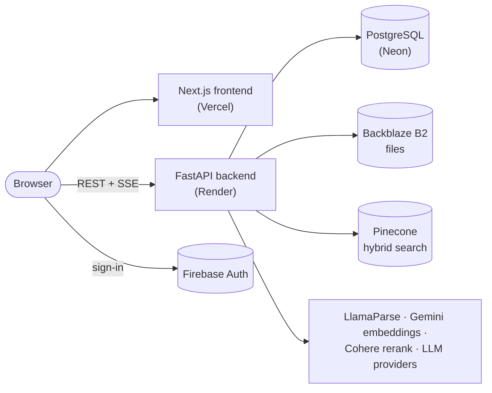
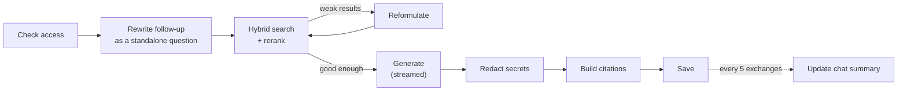

<div align="center">

<picture>
  <source media="(prefers-color-scheme: dark)" srcset="docs/assets/trench-logo-dark.svg">
  
</picture>

**Chat with your documents. Every answer cited back to its source.**

An agentic RAG knowledge assistant for individuals and teams: upload PDFs, Word files and notes,
ask questions in natural language, and get streamed answers grounded only in your own documents.

[](https://github.com/pavankumarbattineni/Trench/actions/workflows/ci.yml)


**Live:** https://trenchai.vercel.app

</div>

---

## Features

- **Cited answers**: streamed responses whose claims link back to the exact source passage.
- **Interactive answers**: when an answer has figures, the model adds charts, metric cards, tables,
  progress bars or live calculators on its own. Copy buttons on code, JSON, tables and answers.
- **Two knowledge scopes**: private personal documents, and company documents shared within a team.
- **Documents**: PDF, DOCX, TXT and Markdown up to 20 MB, with layout-aware parsing (tables, OCR).
- **Teams**: workspaces with Owner/Admin/Member roles, email invitations and access grants.
- **Models**: works out of the box on Groq; bring your own OpenAI, Anthropic, Gemini or Groq key.
- **Usage & cost**: per-question input, cached and output tokens, priced with LiteLLM's model prices.
- **Account**: email/password or Google sign-in, password reset, light/dark theme.

## Architecture



| Folder | What it is |
|---|---|
| [`trench_backend/`](trench_backend/) | FastAPI API and the LangGraph agent (Python 3.13, SQLAlchemy, Alembic) |
| [`trench_frontend/`](trench_frontend/) | Next.js 16 web app (React 19, TypeScript, Tailwind, TanStack Query) |

Firebase verifies who you are; the backend then issues its own short-lived JWTs for every API call.

## How it works

**Ingestion.** A file is stored in Backblaze B2, parsed to Markdown (LlamaParse for PDF/DOCX), split by
headings into ≤ 512-token chunks, embedded as dense (Gemini) plus sparse (Pinecone) vectors, and stored
in Pinecone under a per-user or per-team namespace.

**Answering.** Each chat turn runs a LangGraph agent:



The model sees only the retrieved passages and the recent conversation, and must cite every claim
as `[n]`. Every 5 exchanges, the conversation so far is folded into a short summary; after that the
model gets the summary plus only the exchanges since it (always at least the last one). Answers
stream over Server-Sent Events, can be stopped, and continue after an interruption.

## Getting started

**You need:** Docker Desktop (or uv, Node.js 24 and PostgreSQL 18 to run natively), plus free accounts
for Firebase, Pinecone, Google AI Studio, Groq, Cohere, LlamaCloud and Backblaze B2.

### 1. Configure

```bash
git clone https://github.com/pavankumarbattineni/Trench.git && cd Trench
cp trench_backend/.env.example trench_backend/.env    # fill in every value
```

Create `trench_frontend/.env.local` with `NEXT_PUBLIC_API_BASE_URL=http://localhost:8000` and your
Firebase web config (`NEXT_PUBLIC_FIREBASE_API_KEY`, `_AUTH_DOMAIN`, `_PROJECT_ID`, `_STORAGE_BUCKET`,
`_MESSAGING_SENDER_ID`, `_APP_ID`).

> [!IMPORTANT]
> `.env*` files and service-account JSON are git-ignored. Never commit them.

### 2a. Run with Docker Compose (recommended)

Create `trench_backend/.env.compose` with `POSTGRES_USER`, `POSTGRES_PASSWORD`, `POSTGRES_DB` and a
one-line `TRENCH_CONFIG` whose `DB.ip_address` is `postgres`. Then:

```bash
docker compose --env-file trench_frontend/.env.local up --build -d
```

Open http://localhost:3000 (API docs at http://localhost:8000/docs). Migrations and the model catalog
seed run automatically, and backend code hot-reloads.

### 2b. Run natively

```bash
cd trench_backend
uv sync
uv run alembic upgrade head
uv run python scripts/seed_provider_catalog.py
uv run uvicorn app.main:app --reload --port 8000

cd ../trench_frontend
npm ci && npm run dev
```

## Configuration

All backend settings live in one JSON environment variable, `TRENCH_CONFIG`, validated at startup by
[`app/config.py`](trench_backend/app/config.py). [`.env.example`](trench_backend/.env.example) is the
full template. It holds the database connection, JWT and encryption secrets, the Firebase service
account, API keys for each external service, and email settings (Gmail API in production, SMTP locally).

Frontend `NEXT_PUBLIC_*` values are public and baked in at build time: changing one means rebuilding.

## Development

```bash
# Backend: needs a migrated, seeded database; external APIs are mocked
cd trench_backend
uv run pytest
uv run ruff check . && uv run ruff format .

# Frontend
cd trench_frontend
npm run lint && npx tsc --noEmit && npm run build
```

After changing `app/database/models.py`, create a migration with
`uv run alembic revision --autogenerate -m "describe change"` and review it.

**Branches.** `development` (protected, deploys on merge) and `main` (stable) are the only permanent
branches. Work on short-lived branches named `Trench-<N>[-Title]` cut from `development`, use
[Conventional Commits](https://www.conventionalcommits.org/), and open a pull request into
`development`. CI must pass before merging.

## CI/CD

- **CI** ([`ci.yml`](.github/workflows/ci.yml)), on every push and pull request: backend lint and tests
  against Postgres, frontend lint, type check and build, and Docker image builds scanned with Trivy.
  Dependabot opens weekly update PRs.
- **CD** ([`deploy.yml`](.github/workflows/deploy.yml)), after CI passes on `development`: migrate Neon
  staging, wait for approval, migrate production, deploy the exact commit to Render, wait for `/health`
  to report it, then deploy the frontend to Vercel.

| Component | Platform |
|---|---|
| Frontend | Vercel |
| Backend | Render (Docker, 512 MB, sleeps after 15 min idle) |
| Database | Neon PostgreSQL (`production` and `staging` branches) |

**Rollback:** Render → Deploys → Rollback; Vercel → Deployments → Instant Rollback; Neon → Restore to a
point in time.

## Known limitations

- The stream manager and rate limiter are in memory, so the backend runs as a single process.
- Secret redaction applies to the saved answer, not to tokens already streamed.
- On Render's free tier, the first request after 15 minutes idle is slow.
